<div align="center">


# Faxina

**Limpeza de disco para Windows e Android, sem susto.**

Mostra o que dá para apagar, separa o que é cache do que é seu<br>
e pode passar sozinha uma vez por mês.


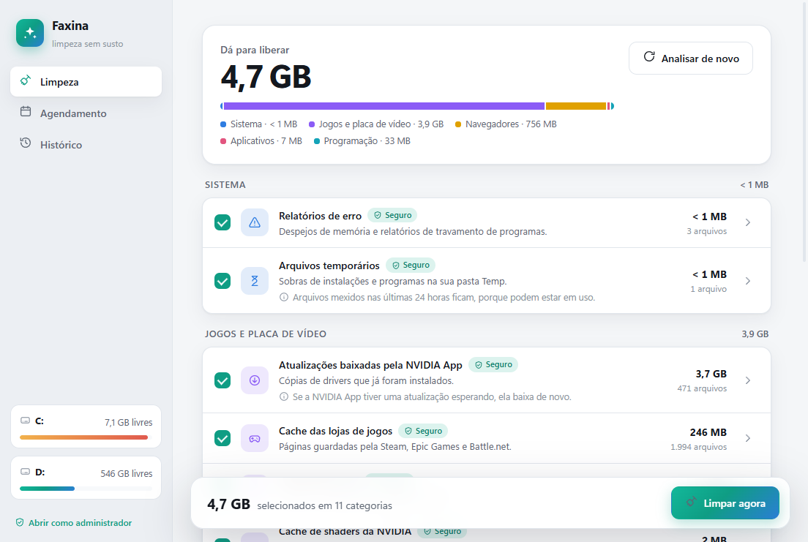

</div>

---

## Sumário

- [Por que existe](#por-que-existe)
- [O que ela faz](#o-que-ela-faz)
- [O que ela limpa](#o-que-ela-limpa)
- [Como ela decide o que pode apagar](#como-ela-decide-o-que-pode-apagar)
- [Faxina automática](#faxina-automática)
- [Telas](#telas)
- [Instalar e rodar](#instalar-e-rodar)
- [Versão Android](#versão-android)
- [Estrutura do projeto](#estrutura-do-projeto)
- [Próximos passos](#próximos-passos)

---

## Por que existe

Em outubro de 2026, uma limpeza feita à mão liberou **52 GB** num PC que
parecia cheio. O maior pedaço, **23 GB**, era um cache que quase ninguém
conhece: os *shaders* que a placa de vídeo da NVIDIA compila para os
jogos e guarda para sempre. O resto estava espalhado em instaladores
esquecidos na pasta Downloads, arquivos temporários e caches de
navegador, de launcher de jogo e de ferramentas de programação.

A Limpeza de Disco do Windows não olha nada disso. Os programas que
olham costumam apagar tudo de uma vez, sem mostrar o quê. A Faxina faz
o caminho do meio: **mostra tudo antes, explica cada item e só apaga o
que você deixar.**

## O que ela faz

- **Analisa em segundos**, só lendo, e mostra quanto dá para
  liberar, separado por grupo, com os maiores itens de cada categoria.
- **Separa o seguro do pessoal.** Cache que o programa refaz sozinho vem
  marcado como *Seguro*. Instaladores, lixeira e músicas offline vêm
  como *Revisar* e pedem confirmação.
- **Cache sai de vez, arquivo seu vai para a lixeira.** Mandar cache
  para a lixeira não libera espaço; mandar um instalador permite desfazer.
- **Pula o que está em uso.** Arquivo aberto ou mexido nas últimas 24
  horas fica para a próxima, sem erro e sem forçar nada.
- **Passa sozinha, se você quiser**, toda semana ou todo mês, e avisa por
  notificação do Windows.
- **Guarda o histórico** de quanto já foi liberado.
- Tema claro e escuro, seguindo o Windows.

## O que ela limpa

| Grupo | O quê | Nível |
|---|---|---|
| **Sistema** | Arquivos temporários do usuário e do Windows, downloads do Windows Update, relatórios de erro | Seguro |
| | Lixeira | Revisar |
| **Jogos e placa de vídeo** | Cache de shaders da NVIDIA, AMD, Intel e DirectX | Seguro |
| | Drivers já instalados que a NVIDIA App guardou | Seguro |
| | Cache da Steam, Epic Games e Battle.net | Seguro |
| **Navegadores** | Cache do Chrome, Edge, Brave, Vivaldi, Opera, Opera GX e Firefox. Senhas, histórico e login não são tocados | Seguro |
| **Aplicativos** | Discord, Visual Studio Code | Seguro |
| | Spotify (inclui as músicas baixadas para ouvir offline) | Revisar |
| **Programação** | pip, uv, npm, Yarn, NuGet | Seguro |
| **Seus arquivos** | Instaladores (`.exe`, `.msi`, `.msix`) na pasta Downloads, escolhidos um a um | Revisar |

Categoria que não existe no PC (um navegador que não está instalado, por
exemplo) simplesmente não aparece.

## Como ela decide o que pode apagar

Um app que apaga arquivos tem que errar para o lado da cautela. Estas
regras estão no código (`faxina/motor.py`) e nos testes
(`testes/test_motor.py`):

1. **Só pastas conhecidas.** Cada categoria aponta para pastas fixas no
   código. Nada vem de fora, nem da própria tela: a limpeza só aceita
   itens que a análise acabou de encontrar.
2. **Última conferência antes de apagar.** Cada item tem que estar
   dentro da pasta da sua categoria, não pode ser uma pasta protegida
   (Windows, Program Files, Documentos, Downloads, Área de Trabalho, a
   raiz do disco…) nem conter uma. Dentro da pasta do Windows, só
   `Temp` e `SoftwareDistribution\Download`.
3. **Atalho de pasta não é seguido.** Uma junção dentro do Temp
   apontando para Documentos é removida como atalho; Documentos fica
   intacto. Esse é o erro clássico de limpadores, e tem teste para ele.
4. **Nada é forçado.** Arquivo em uso ou sem permissão é pulado e
   contado na tela final.
5. **A limpeza automática nunca mexe no que é *Revisar*.**

## Faxina automática

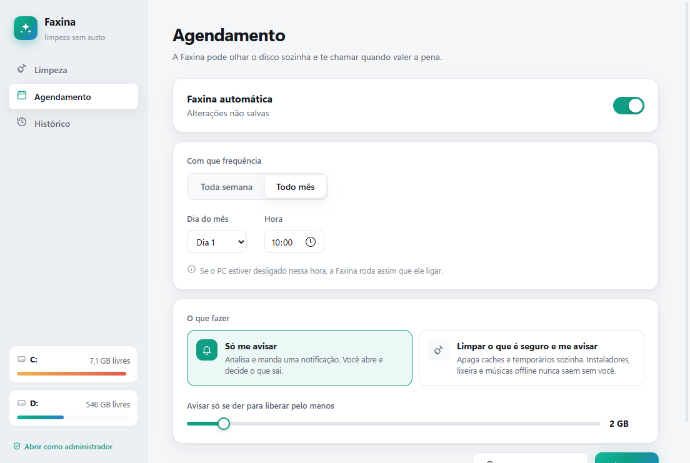

- **Frequência:** toda semana (escolhe o dia) ou todo mês (dia 1 a 28),
  no horário que você quiser.
- **Dois modos:**
  - *Só me avisar*: analisa e manda uma notificação quando dá para
    liberar mais do que o limite escolhido.
  - *Limpar o que é seguro e me avisar*: apaga caches e temporários
    sozinha e conta quanto liberou.
- **PC desligado na hora marcada?** Ela roda assim que ele ligar.
- Usa o **Agendador de Tarefas do Windows**: não fica nenhum processo
  rodando em segundo plano.
- Clicar na notificação abre a Faxina.

## Telas

| | |
|:---:|:---:|
| 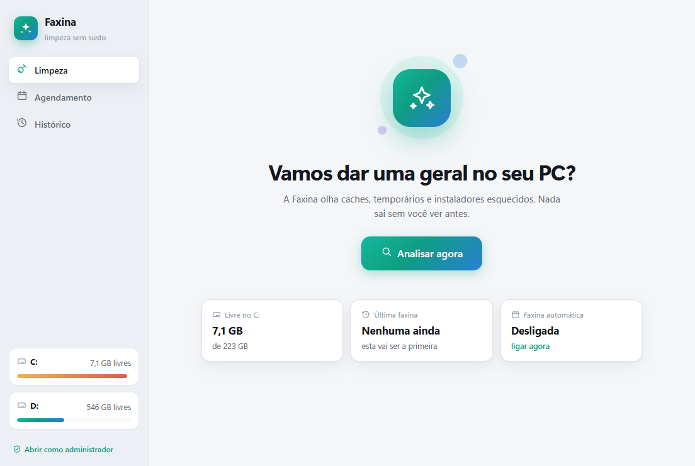<br>**Início** | 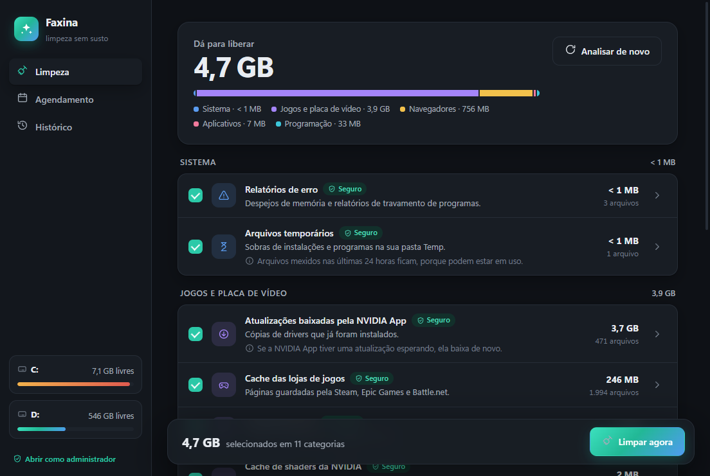<br>**Análise, tema escuro** |
| 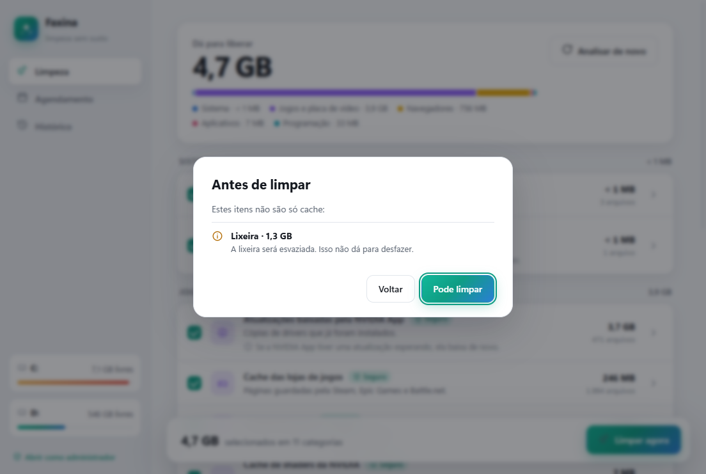<br>**Confirmação do que não é cache** | 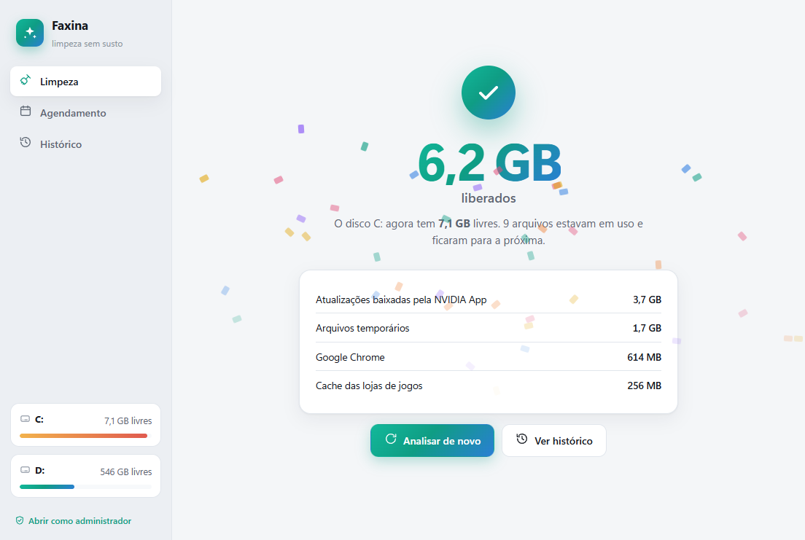<br>**Fim da faxina (exemplo)** |

## Instalar e rodar

A Faxina ainda está em testes e não tem instalador. Para rodar, é preciso
o [uv](https://docs.astral.sh/uv/) (ou Python 3.12 com pip) e o
WebView2, que já vem no Windows 11.

```powershell
git clone https://github.com/Luisinho13/faxina.git
cd faxina
uv venv -p 3.12 .venv
uv pip install --python .venv\Scripts\python.exe pywebview send2trash winotify
.venv\Scripts\python.exe main.py
```

> Python 3.12 de propósito: o pywebview depende do pythonnet, e é no
> 3.12 que o projeto foi testado.

### Testes

```powershell
uv pip install --python .venv\Scripts\python.exe pytest
.venv\Scripts\python.exe -m pytest
```

Os testes criam uma pasta de rascunho e não tocam em nada fora dela.

### Gerar o executável

```powershell
uv pip install --python .venv\Scripts\python.exe pyinstaller pillow
.venv\Scripts\pyinstaller.exe --noconfirm --clean --windowed --name Faxina `
  --icon recursos\faxina.ico --add-data "ui;ui" --add-data "recursos;recursos" main.py
```

O app sai em `dist\Faxina\` (cerca de 26 MB). Para usar no dia a dia,
copie essa pasta para um lugar fixo: o agendamento aponta para o
caminho do `Faxina.exe`.

## Versão Android

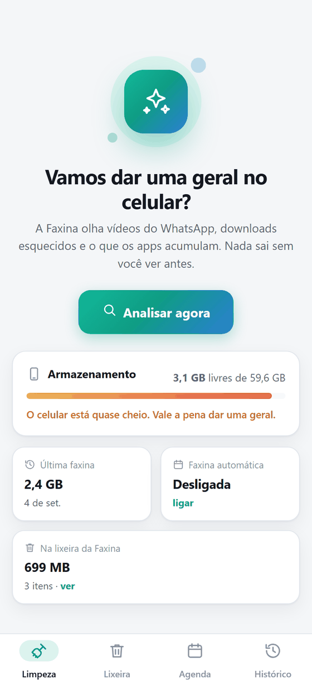
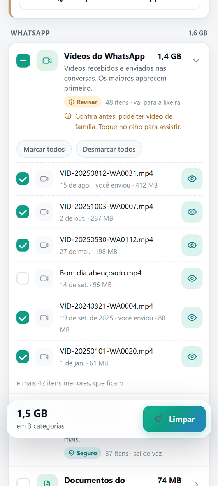
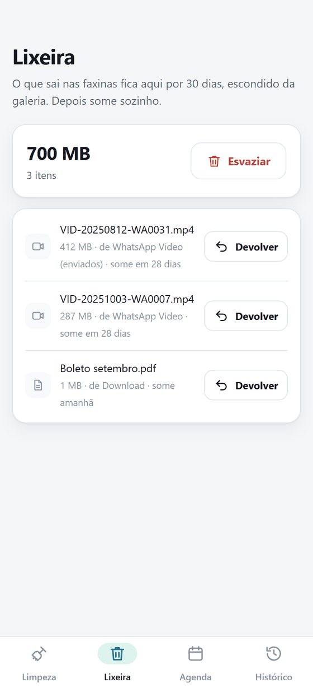

No celular, o que enche o armazenamento é outra coisa: vídeos que
chegam pelo WhatsApp, instaladores e downloads esquecidos, e o cache que
os apps acumulam. A Faxina para Android olha isso, com a mesma cara e as
mesmas regras da versão do PC.

> ⚠️ **Pré-lançamento.** O motor tem testes e a tela foi conferida, mas o
> app ainda não foi usado num celular de verdade.

### O que ela limpa no celular

| Grupo | O quê | Nível |
|---|---|---|
| **WhatsApp** | Vídeos recebidos e enviados, escolhidos um a um, com botão para assistir antes | Revisar |
| | Documentos recebidos (PDFs, planilhas…), um a um | Revisar |
| | Status já vistos, com mais de um dia | Seguro |
| **Seus arquivos** | Instaladores `.apk` na pasta Download | Revisar |
| | O que está na pasta Download há mais de 3 meses | Revisar |
| **Sistema** | Miniaturas da galeria (ela refaz sozinha) | Seguro |
| | Lixeira da Faxina | Revisar |
| **Aplicativos** | Cache de todos os apps, pelo próprio Android, que pergunta antes (Android 11+) | — |

Conversas e backups do WhatsApp nunca entram. Fotos e vídeos da câmera
também não.

### O que muda em relação ao PC

- **Sem internet.** O app nem tem a permissão de usar a internet: não tem
  como mandar nada para fora do celular.
- **Uma lixeira própria.** O Android não tem uma lixeira que sirva para
  tudo, então a Faxina tem a dela: o que é seu fica 30 dias numa pasta
  escondida da galeria, com botão **Devolver**, e depois some sozinho.
  Dá para esvaziar antes, se precisar do espaço já.
- **O `.nomedia` nunca sai.** É ele que esconde da galeria as pastas
  privadas; apagá-lo faria fotos escondidas aparecerem.
- **A faxina automática só avisa.** Toda semana ou todo mês ela olha o
  celular e manda uma notificação se der para liberar mais que o limite.
  No celular ela nunca apaga nada sozinha.

| | | |
|:---:|:---:|:---:|
| 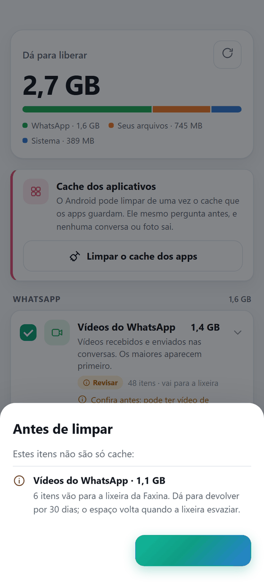<br>**Confirmação** | 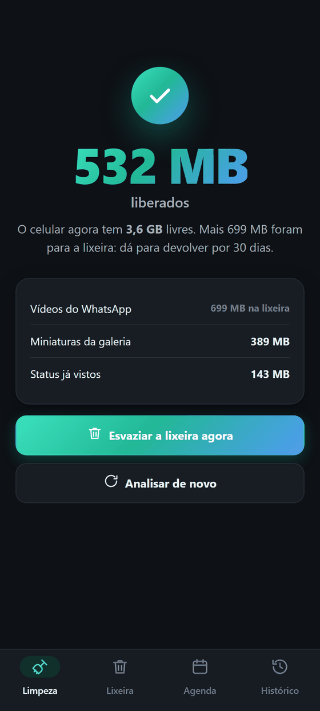<br>**Fim da faxina, tema escuro** | 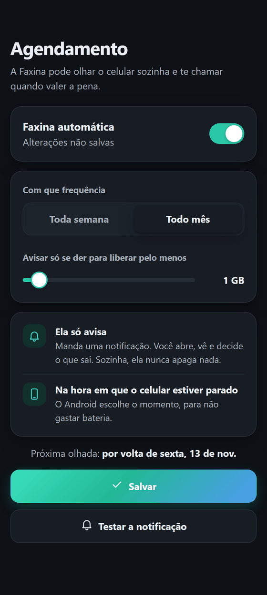<br>**Agendamento** |

<sub>Telas com dados de exemplo.</sub>

### Instalar no celular

Baixe o `Faxina-0.1.apk` na página do
[release android-v0.1](https://github.com/Luisinho13/faxina/releases/tag/android-v0.1)
pelo próprio celular e toque nele. O Android pede para permitir
"instalar apps desconhecidos"; se o Play Protect avisar, é só tocar em
*Instalar mesmo assim*. Ao abrir, a Faxina pede o acesso aos arquivos.

Precisa de Android 8 ou mais novo. A limpeza do cache dos apps só aparece
no Android 11 ou mais novo.

### Compilar

Precisa do JDK 17 e do SDK do Android (plataforma 35). Com o
`local.properties` apontando para o SDK:

```powershell
cd android
.\gradlew.bat testDebugUnitTest   # testes do motor, rodam no PC
.\gradlew.bat assembleRelease     # sai em app\build\outputs\apk\release
```

Sem `keystore.properties` (que fica fora do repositório), o APK sai
assinado com a chave de depuração da máquina.

Para ver a tela sem celular, `android\teste-tela\fotografar.ps1` abre o
app no Edge, no tamanho de um celular e com dados de exemplo, e tira uma
foto de cada tela.

## Estrutura do projeto

```
faxina/
├── main.py              abre a janela; com --agendado, roda sem janela
├── faxina/
│   ├── categorias.py    o catálogo: o que limpar, onde e com que nível
│   ├── motor.py         análise (só lê) e limpeza, com as regras de segurança
│   ├── pastas.py        pastas do Windows e a lista de protegidas
│   ├── api.py           a ponte entre a tela e o Python
│   ├── agenda.py        tarefa no Agendador, protocolo faxina:// e notificações
│   ├── rotina.py        o que roda na faxina automática
│   ├── aviso.py         notificação do Windows
│   └── dados.py         configuração e histórico (%LOCALAPPDATA%\Faxina)
├── ui/                  a tela: HTML, CSS e JavaScript, sem internet
├── recursos/            ícone
├── testes/              testes do motor
├── android/             a versão para celular
│   ├── app/src/main/
│   │   ├── java/…/faxina/   motor, lixeira e catálogo (Kotlin), ponte com a tela
│   │   └── assets/ui/       a tela do celular
│   ├── app/src/test/        testes do motor
│   └── teste-tela/          dados de exemplo e fotos da tela no PC
└── docs/imagens/        prints deste README
```

## Próximos passos

- [ ] Instalador, com atalho no Menu Iniciar
- [ ] Assinatura digital do executável (sem ela, o Windows mostra o aviso
      do SmartScreen)
- [ ] Mais launchers de jogo (Ubisoft Connect, EA App, Riot)
- [ ] Opção de desligar a hibernação (libera o tamanho da memória RAM em
      disco)
- [ ] Android: primeiro uso num celular de verdade
- [ ] Android: fotos repetidas e áudios do WhatsApp
- [ ] Nome definitivo

---

<div align="center">
<sub>Criado por Luis Felipe · © 2026 · Todos os direitos reservados.<br>
O código é público para consulta; uso e cópia dependem de autorização.</sub>
</div>
